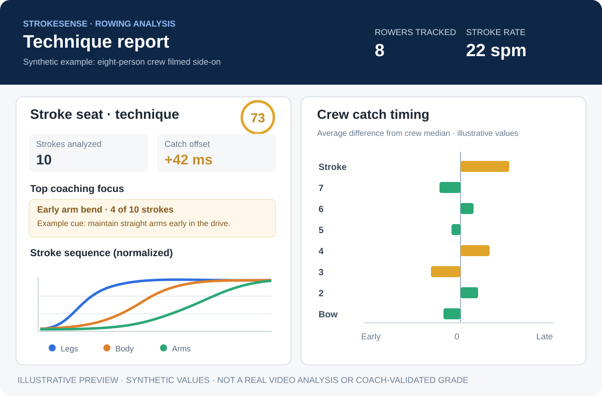

# Selected Startup: StrokeSense — Verified rowing technique feedback

**Product concept:** StrokeSense helps rowers and coaches turn ordinary rowing footage into interpretable technique feedback: recurring faults, stroke sequencing, and—when a crew is visible—catch-timing differences by seat.

**Y Combinator inspiration:** [HYBRD (YC Fall 2024)](https://www.ycombinator.com/companies/hybrd) applies adaptive AI coaching to athlete training data. StrokeSense adapts the broader AI-coaching concept to **rowing-specific video biomechanics and evidence-backed corrections**. We do not claim HYBRD offers this rowing video feature.

## Existing prototype and website-report example

The team currently has a working **Python CLI technique analyzer** in [strokesense/](../strokesense/). It uses markerless pose estimation, stroke segmentation, heuristic fault detection, and creates a browser-viewable HTML coaching report, annotated video, and structured JSON metrics.

*This is a mock preview using synthetic values; it is not a real video-analysis screenshot.*

**Concrete rowing example:** Consider a short, side-on recording of an eight-person crew. Suppose the stroke seat has 10 usable strokes at 22 spm, early arm bend appears in 4 strokes, and the mean catch offset is +42 ms relative to the crew's median. StrokeSense can organize this kind of analysis into per-seat summaries, sequencing charts, footage annotations, and crew timing charts. A coach decides whether the flagged pattern warrants correction. These example values are illustrative.

## How we address the eight project requirements

### 1. Solves one specific problem well

Rowers and coaches need a faster way to find **recurring technique and synchronization issues** in practice footage without manually inspecting every stroke. The first product focuses on short side-on erg and crew videos, not an all-purpose fitness tracker or injury diagnosis.

### 2. We know or can access target customers

Initial audiences are individual erg users, rowing clubs, collegiate crews, and coaches. The team can recruit volunteers from rowing communities for consented pilot clips and seek coaches' feedback. We still need to validate demand, repeat use, and willingness to pay.

### 3. Familiarity with the infrastructure

The existing tool uses Python, NumPy, SciPy, OpenCV, ONNX Runtime, and Matplotlib. A YOLO11-pose network provides joints; deterministic tracking, kinematics, and fault rules generate reports. A deployable product could add a Python API, a video-upload web frontend, a processing queue, cloud object storage, and an LLM service.

### 4. Reimagines the problem

The current tool highlights recurring stroke-pattern evidence, per-seat findings, and crew timing instead of relying entirely on manual frame-by-frame review. The proposed product takes the next step: explain a measured issue, suggest a coach-approved correction, and let athletes compare subsequent recordings.

Rowing video-analysis competitors already exist, so differentiation must be demonstrated through trustworthy evidence-linked feedback and actual customer adoption, not claims of being the first AI rowing coach.

### 5. A generative model is core to the proposed product

**Not yet implemented:** An LLM would read validated stroke measurements and a selected coach-approved drill library, then generate a personalized coaching explanation referencing the actual stroke and issue. It would choose the relevant cue and explain the sequence without fabricating measurements or diagnosing injuries.

**Current status:** The prototype uses computer vision and deterministic heuristics, **not an LLM**. Building the coaching generation layer is required to fully meet this assignment criterion.

### 6. Independent validation before generated output is released

**Proposed guardrail:** Require a structured output containing seat ID, stroke indices, fault codes, quantitative claims, and drill/cue identifiers. A separate validator checks that references exist, numeric claims match saved metrics, the recommended cue is approved for the given fault, and there is enough tracking evidence for an interpretable statement. Unverifiable feedback is withheld.

The existing synthetic unit tests check some detector behavior. They **do not yet implement this LLM-output release gate** or establish diagnostic accuracy on real footage.

### 7. Automatic self-correction

**Proposed loop:** If a generated explanation cites a nonexistent stroke, misstates a measured percentage, or chooses an unsupported cue, the validator returns a precise machine-readable error. The LLM revises the candidate and is rechecked for at most three attempts. It cannot modify measurements, allowed rules, or validators. Persistent failures go to coach review without releasing unverified feedback.

**Current status:** This LLM retry loop is future work.

### 8. Deployable MVP

**What works today:** The local CLI creates annotated video, HTML reports, and JSON metrics. It is runnable with supported Python dependencies and suitable footage.

**Next deployment steps:** Build a consent-based video upload interface, queue jobs for video analysis, store clips privately, show report results, and implement the validated LLM coaching loop. Start with a bounded processing size and clear limitations before widening support to varied camera angles.

## Suggested live demo

1. Run the analyzer on a short side-on erg or crew recording from the strokesense directory.
2. Open the resulting report.html in a browser; show the per-seat findings, catch/finish snapshots, and graphs.
3. Show the annotated video and any crew timing offsets.
4. Run the synthetic fault tests using the commands in the [technical README](../strokesense/README.md).
5. **Planned LLM demo:** Intentionally create a coaching candidate with a wrong stroke reference or percentage, reject it, retry, and show only a valid corrected explanation.

## Metrics and safeguards

**Validation metrics:** Coach agreement on technique labels, false positives/negatives across camera angles, agreement on catch timing, percentage of generated coaching statements that pass independent checks, retry success rate, and time saved reviewing clips.

**Limitations:** Side-view 2D poses, occlusion, low frame rates, and heuristic thresholds can distort measurement. Test with real consented footage and expert labels before making performance or safety claims. The prototype does not establish injury prevention or guarantee better rowing performance.
