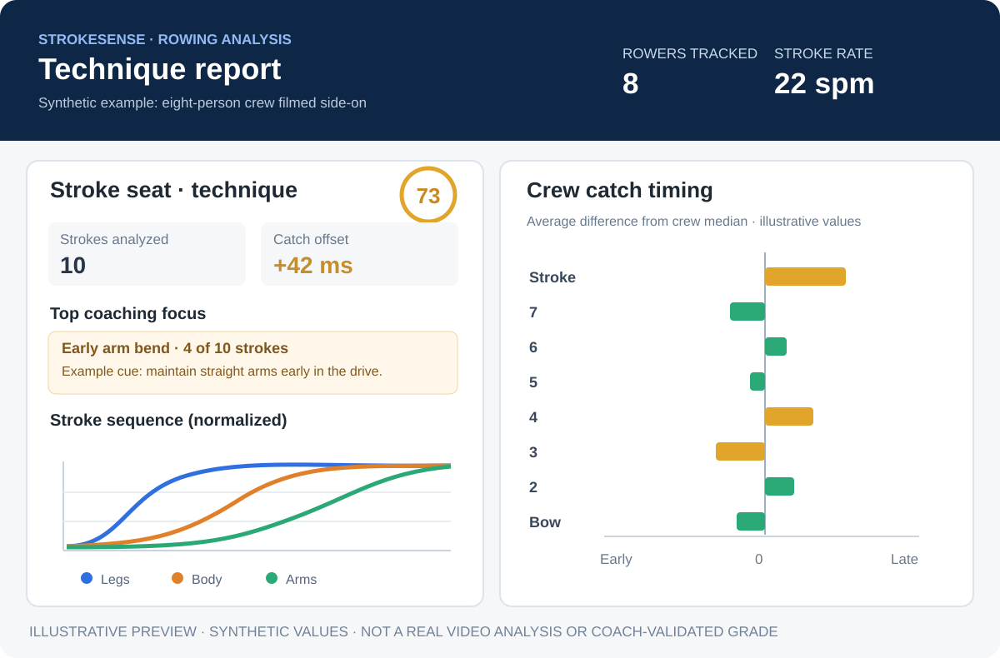

# StrokeSense — Video-based rowing technique analysis

**StrokeSense** analyzes rowing footage using markerless computer vision, highlights recurring technique patterns, and produces a visual coaching report for individual rowers or a crew. It is a prototype intended to support—not replace—a rowing coach's judgment.

## Live public website

**[StrokeSense website](https://strokesense-review.vercel.app/)** · **[Live video analyzer and dashboard](https://strokesense-review.vercel.app/demos/)** · **[Reviewer feedback study](https://strokesense-review.kemalgcortuk.chatgpt.site/)**

The Vercel website provides the full visible analyzer: choose the prepared rowing clip or upload an MP4, MOV, or WebM video (up to 100 MB), follow analysis progress, play the annotated result, and read the built-in coaching dashboard. The report supports **By technique** and **By rower** views, with sorting for numeric technique comparisons. Render performs the processing and generates model-assisted coaching feedback in the background; visitors do not need to open a separate Render page. The original study site continues to hold private reviewer participation and results. Both deployment branches retain the shared analyzer, dashboard API, and LLM report code.

### Deployment branches

| Branch | Active `render.yaml` | Responsibility |
| --- | --- | --- |
| `dev-consolidated` | `strokesense-alpha` | Reviewer feedback study; retains the study's persistent data and settings. |
| `strokesense-render-live` | `strokesense-real-analysis-demo` | Paid compute-backed video uploads, cancellation, tracking, and coaching reports for the Vercel site. |

The application code and related tests are kept aligned across these branches, while their active Render Blueprints stay separate. To deploy a **second** compute service from `dev-consolidated`, review the optional [`render-demo.yaml`](render-demo.yaml), which uses its own `strokesense-dev-analysis-demo` service and `strokesense-dev-demo` disk names, and approve any paid resource changes in Render yourself. Merging code does not switch either running service or migrate stored videos, reports, or study data.

## Report preview

*Illustrative preview with synthetic values. This image shows the style and content of the browser-viewable report; it is **not** a screenshot from a real video analysis or a coach-validated score.*

### Example rowing analysis

Imagine filming an eight-person crew from a launch, side-on, for a short piece. For this **synthetic example**, the stroke seat's report contains:

| Example measurement | Illustrative result | Interpretation |
| --- | --- | --- |
| Stroke rate | 22 spm | Estimated strokes per minute |
| Strokes analyzed | 10 | Strokes with usable measurements |
| Early arm bend | 4 of 10 strokes | Rule flags early elbow flexion during the drive |
| Catch offset | +42 ms | Catch was later than the crew median on average |

A coach could review the highlighted frames and sequencing chart, investigate early arm bend, and compare a later clip from the same camera angle. **These numbers are for illustration, not measured results from a particular athlete.**

## What is implemented now

- Processes a local **side-on erg video or launch footage of a crew**.
- Uses pretrained **YOLO11-pose via ONNX Runtime** for markerless person and joint estimation.
- Identifies rowers, segments strokes, and estimates body angles, rate, and drive/recovery sequencing.
- Flags recurring movements using explicit configurable heuristics (for example, early arms, shooting the slide, rushed recovery, too much layback).
- Estimates crew catch timing per seat relative to the crew median.
- Creates an **annotated video**, an **HTML coaching report**, and **JSON metrics**.

The default local workflow documented below is a Python command-line analyzer that writes report files. The separately deployed **Vercel + Render demo** adds a hosted upload workflow, native browser dashboard, and LLM-assisted coaching.

## Run locally

For complete details, see the teammate-maintained [StrokeSense setup guide](strokesense/README.md). The root README summarizes the existing interface; it does not replace those technical instructions.

Requirements: Python 3 and the packages listed in the project requirements. FFmpeg is optional but useful for MP4 output.

### Windows PowerShell (from repository root)

~~~powershell
cd strokesense
py -3 -m venv .venv
.\.venv\Scripts\Activate.ps1
pip install -r requirements.txt

# A single indoor rower:
python -m strokesense.cli "C:\path\to\erg.mp4" --single

# A side-on crew clip:
python -m strokesense.cli "C:\path\to\crew.mp4" --start 5 --duration 30
~~~

For macOS/Linux, activate the environment with source .venv/bin/activate and use python3 if needed.

Successful runs write to a results folder named for the input video. Open its report.html in a browser to view technique cards, photos, and charts.

### Deterministic detector tests

~~~powershell
cd strokesense
python tests\test_analysis.py
~~~

These tests inject known technique patterns into **synthetic pose sequences**. They do **not** establish diagnostic accuracy on real rowing videos.

## Hosted LLM coaching and planned safeguards

The hosted Render pipeline can generate coaching observations from its measured stroke metrics and expose them in the Vercel dashboard. The dashboard shows LLM feedback only when its report sidecar passes the backend's provenance checks; estimated measurements and machine-generated guidance still require coach review.

A future enhancement would add a coach-approved cue library and an **independent content validator** to check cited seat/stroke IDs, measurements, and cue IDs before publication, with bounded retries for invalid candidates. That separate semantic-validation and retry workflow remains **planned**, not a claim about the deployed service. See the [selected startup proposal](README-startups/readme-startupSelected.md) for the eight project criteria and delivery plan.

## Accuracy and privacy limits

- Single-camera 2D body angles depend on camera alignment, visibility, and occlusion. Full-crew seat tracking can be unreliable with overlapping rowers.
- Coaching thresholds are exploratory heuristics requiring real footage and coach-label validation; an automatically calculated score is not proof of athlete skill or improved speed.
- Use footage with athletes' consent. Do not commit identifiable practice video or private results to a public repository.
- StrokeSense does not diagnose injury or replace professional coaching.
